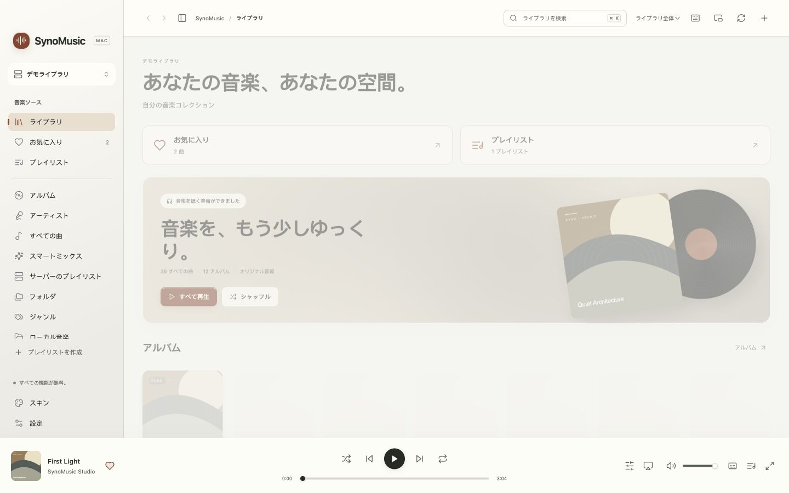
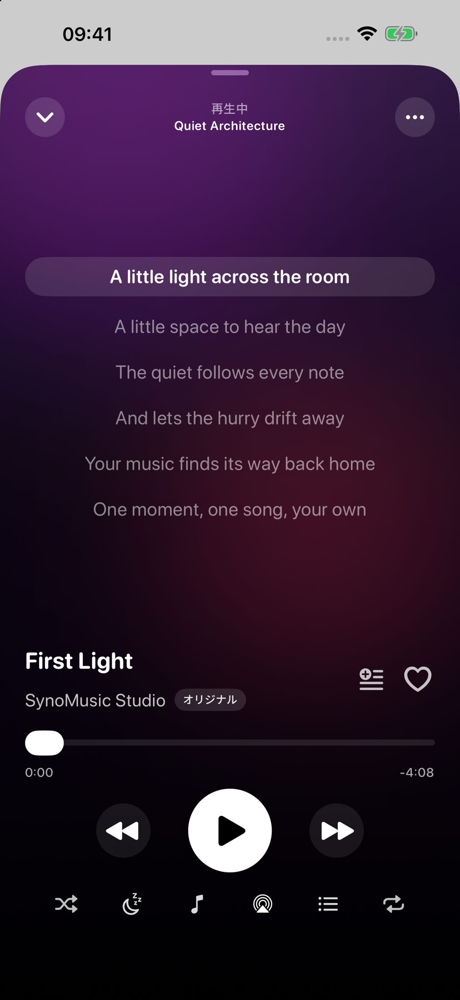
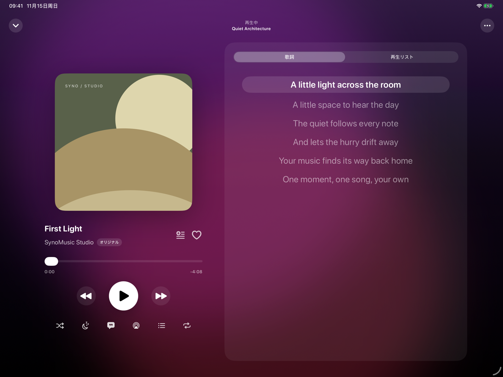
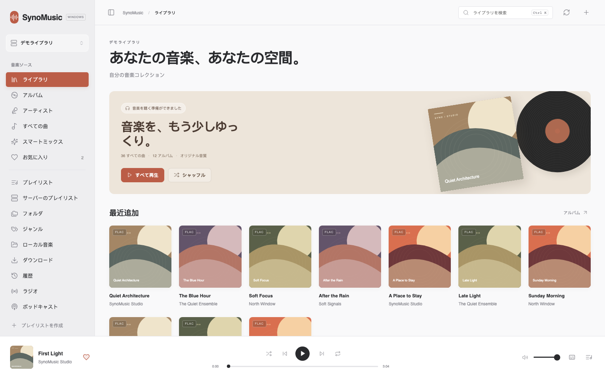
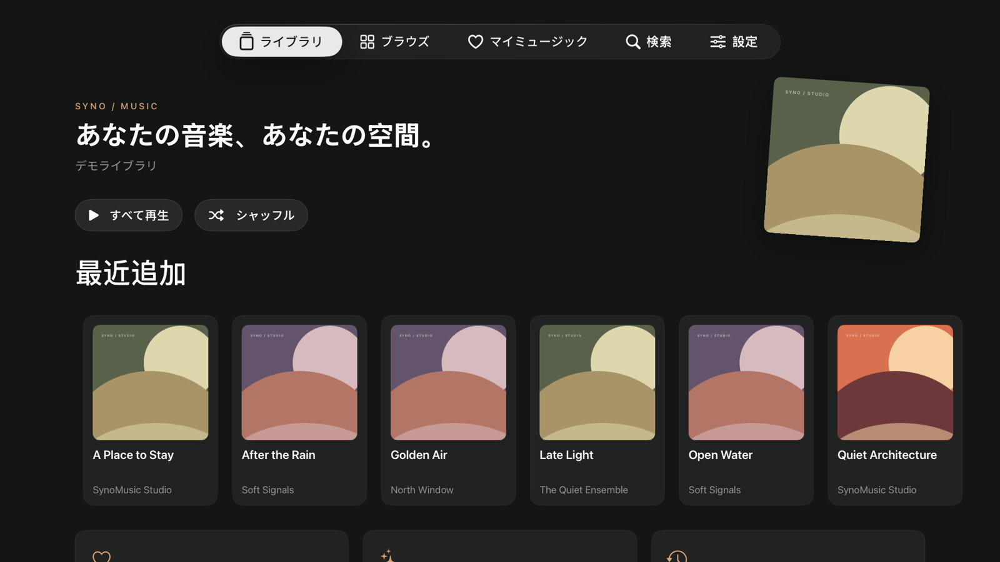

<p align="center">
  
</p>

# SynoMusic

自分の音楽に、居心地のよい場所を。**iPhone、iPad、Mac、Windows、Apple TV** に対応する、無料のオープンソース音楽クライアントです。

[English](README.md) · [简体中文](README.zh.md) · [日本語](README.ja.md) · [한국어](README.ko.md)

[公式サイト](https://zanwingmak.github.io/SynoMusic/) · [App Store](https://apps.apple.com/app/id6784094020) · [デスクトップ版](https://github.com/ZanwingMak/SynoMusic/releases/latest) · [問題を報告](https://github.com/ZanwingMak/SynoMusic/issues)

Synology Audio Station、Plex、Jellyfin、Emby、WebDAV、SMB の音楽ライブラリに接続できます。スマートフォン、タブレット、パソコンではローカル音声ファイルも読み込めます。タッチ操作、デスクトップ、Siri Remote に合わせ、それぞれの画面を設計しています。

**すべての機能を無料で利用できます。** 任意の支援購入は開発者への応援のみを目的とし、機能の解除や自動更新はありません。SynoMusic アカウントは不要です。商用の楽曲カタログは付属しません。

## ダウンロード

| クライアント | 動作要件 | バージョン | 入手先 |
| --- | --- | --- | --- |
| iPhone | iOS 17 以降 | 1.7.0 | [App Store](https://apps.apple.com/app/id6784094020) |
| iPad | iPadOS 17 以降 | 1.7.0 | [App Store](https://apps.apple.com/app/id6784094020) |
| Mac | macOS 13 以降、Apple Silicon / Intel | 1.6.12 | [App Store](https://apps.apple.com/app/id6784094020) · [Universal DMG](https://github.com/ZanwingMak/SynoMusic/releases/download/v1.6.12/SynoMusic-1.6.12-mac-universal.dmg) |
| Windows | Windows 10/11、WebView2 Runtime | 1.6.12 | [x64](https://github.com/ZanwingMak/SynoMusic/releases/download/v1.6.12/SynoMusic-1.6.12-Windows-x64-setup.exe) · [ARM64](https://github.com/ZanwingMak/SynoMusic/releases/download/v1.6.12/SynoMusic-1.6.12-Windows-arm64-setup.exe) |
| Apple TV | tvOS 17 以降 | 1.7.0 | [App Store](https://apps.apple.com/app/id6784094020) — Apple TV で SynoMusic を検索 |

Mac DMG は Developer ID 署名済みで、Apple の公証を受けています。デスクトップ版と SHA-256 チェックサムは [GitHub Releases](https://github.com/ZanwingMak/SynoMusic/releases/latest) で公開しています。

## スクリーンショット

### Mac



| iPhone | iPad |
| :---: | :---: |
|  |  |

| Windows | Apple TV |
| :---: | :---: |
|  |  |

画面にはオリジナルのデモライブラリを使用しています。掲載された楽曲がアプリに付属することを意味しません。

## 音楽ソースとライブラリ

- **自分のサーバーに接続**：Synology Audio Station、Plex、Jellyfin、Emby、WebDAV、SMB。複数サーバーと Synology QuickConnect に対応。
- **コレクションを探す**：アルバム、アーティスト、ジャンル、フォルダ、すべての曲、サーバープレイリスト、検索。
- **音楽を整理**：お気に入り、ローカルプレイリスト、スマートミックス、再生履歴。
- **曲に合わせて楽しむ**：同期歌詞、再生キュー、シャッフル、リピート、スリープタイマー。
- **オフライン再生**：iPhone、iPad、Mac、Windows でダウンロードとローカル音声の読み込み。
- **音声コンテンツを探す**：ラジオとポッドキャストの閲覧、検索、再生。
- **表示言語**：簡体字中国語、繁体字中国語、英語、日本語、韓国語、ドイツ語、フランス語。

利用できるサーバー機能は接続先とアカウント権限によって異なります。所有している音楽、または利用を許可されたコンテンツのみを接続してください。

## 各クライアントの特徴

### iPhone と iPad

- SwiftUI によるネイティブ画面、バックグラウンド再生、AirPlay、ロック画面操作、Dynamic Island。
- ウィジェット、Siri ショートカット、任意の iCloud 設定同期、テーマカラー、代替アプリアイコン。
- 同期歌詞の編集、文字サイズと表示タイミングの調整。
- iPad のライブラリサイドバー、可変グリッド、アートワーク・歌詞・キューを広く表示するプレーヤー。
- iPhone Duo の折りたたみ、半開き、全開に対応。表示領域が変化してもナビゲーションと検索状態を保持。

### Mac と Windows

- [MyGo](https://github.com/egoist/mygo)、Go、TypeScript とシステム WebView を使ったデスクトップ画面。
- メニューバー / システムトレイでの再生操作、ウィンドウを閉じた後の再生継続設定、ミニプレーヤー、メディアキー、キーボードショートカット。
- お気に入り、同期歌詞、歌詞の読み込み・書き出し、キュー編集、キュー履歴。
- 10 バンド EQ、クロスフェード、ReplayGain（対応タグが必要）、左右バランス、A–B リピート。
- 評価、再生統計、条件指定のスマートプレイリスト。M3U/M3U8/JSON の読み込みと M3U8/JSON の書き出し。
- **Studio、Graphite、Evergreen、Sea glass、Rosewood、Amber** の 6 スキン。各スキンでライト、ダーク、システム連動を選択可能。

### Apple TV

- リモコンのフォーカス、離れた位置からの読みやすさ、大きなアートワークを重視した専用 SwiftUI 画面。
- サーバー音楽ライブラリ、アルバム、アーティスト、フォルダ、ジャンル、検索、サーバープレイリスト。
- お気に入り、ローカルプレイリスト、スマートミックス、履歴、同期歌詞、キュー、スリープタイマー。

## プライバシーと任意の支援

サーバー認証情報は、Apple プラットフォームでは Keychain、Windows では資格情報マネージャーに保存します。アプリは設定したサーバーに接続します。iCloud 同期は任意で、Mac では App Store 版で利用できます。設定同期によってダウンロードした音声やローカルファイルがアップロードされることはありません。

iPhone と iPad の支援購入は、米ドル基準で **$0.99、$1.99、$2.99、$5.99、$9.99** の 5 種類です。いずれも繰り返し購入できる単発の消耗型購入で、実際の現地価格は App Store に表示されます。

過去のサブスクリプションは別途管理が必要です。アプリの更新では自動解約されません。設定内の過去のサブスクリプション管理から確認・解約できます。

[プライバシーポリシー](https://zanwingmak.github.io/SynoMusic/privacy.html) · [利用規約](https://zanwingmak.github.io/SynoMusic/terms.html)

## ソースからビルド

```bash
git clone https://github.com/ZanwingMak/SynoMusic.git
cd SynoMusic
```

### iPhone、iPad、Apple TV

macOS、Xcode 27.2 以降、[XcodeGen](https://github.com/yonaskolb/XcodeGen) が必要です。

```bash
brew install xcodegen
xcodegen generate
open SynoMusic.xcodeproj
```

iPhone / iPad は **SynoMusic**、Apple TV は **SynoMusicTV** スキームを選択します。実機ビルドでは自分の開発チームと署名設定を使用してください。iCloud 機能にも自分の識別子と権限設定が必要です。

### Mac と Windows

デスクトップ構成に合わせ、Node.js 24 と Go 1.27.3 以降を使用します。

```bash
cd desktop
npm ci
```

Mac では Xcode コマンドラインツールを用意し、開発起動前にネイティブブリッジをビルドします。

```bash
npm run build:native
npm run dev
```

Windows では依存関係のインストール後に `npm run dev` を実行します。配布用ビルドは macOS で `npm run build:mac`、Windows で `npm run build:windows` を使用します。Windows は x64 と ARM64 のインストーラーを生成します。配布署名と公証には自分の認証情報が必要です。

## リポジトリ構成

- [`SynoMusic/`](SynoMusic/)：iPhone / iPad アプリ、共通プロバイダー、ストレージ、ウィジェット、Live Activities。
- [`SynoMusicTV/`](SynoMusicTV/)：Apple TV アプリとリモコン用画面。
- [`desktop/`](desktop/)：Mac / Windows アプリ、MyGo サービス、プレーヤー、スキン。
- [`docs/`](docs/)：公式サイト、多言語スクリーンショット、プライバシーポリシー、利用規約。
- [`project.yml`](project.yml)：XcodeGen と Apple プラットフォームのスキーム設定。

現在の公開開発リポジトリは [ZanwingMak/SynoMusic](https://github.com/ZanwingMak/SynoMusic) です。問題報告とコードの貢献はこちらで受け付けています。

## 免責事項とライセンス

SynoMusic は独立した非公式クライアントです。Synology、Plex、Jellyfin、Emby、Apple などの名称は各所有者に帰属します。各プロジェクトや企業との提携・承認関係はありません。

**GNU General Public License v3.0** の下で公開しています。[LICENSE](LICENSE) を参照してください。
