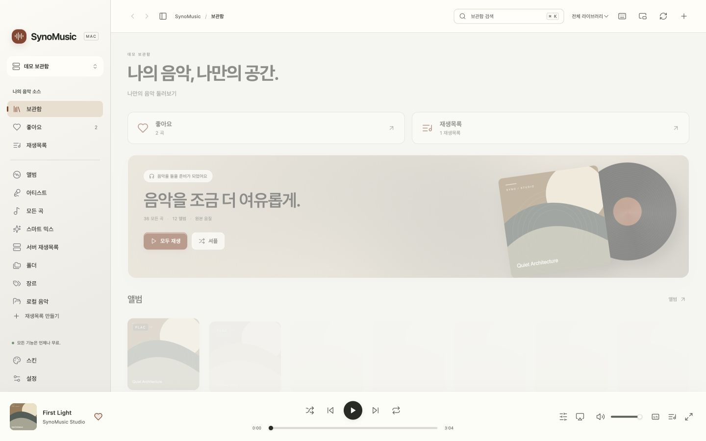
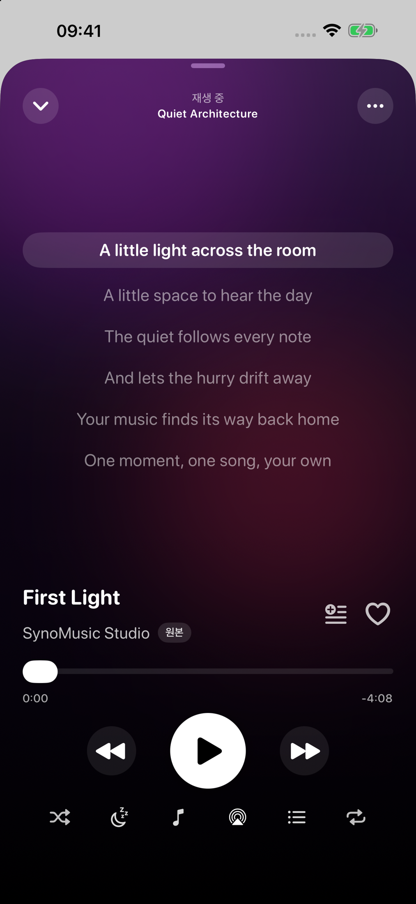
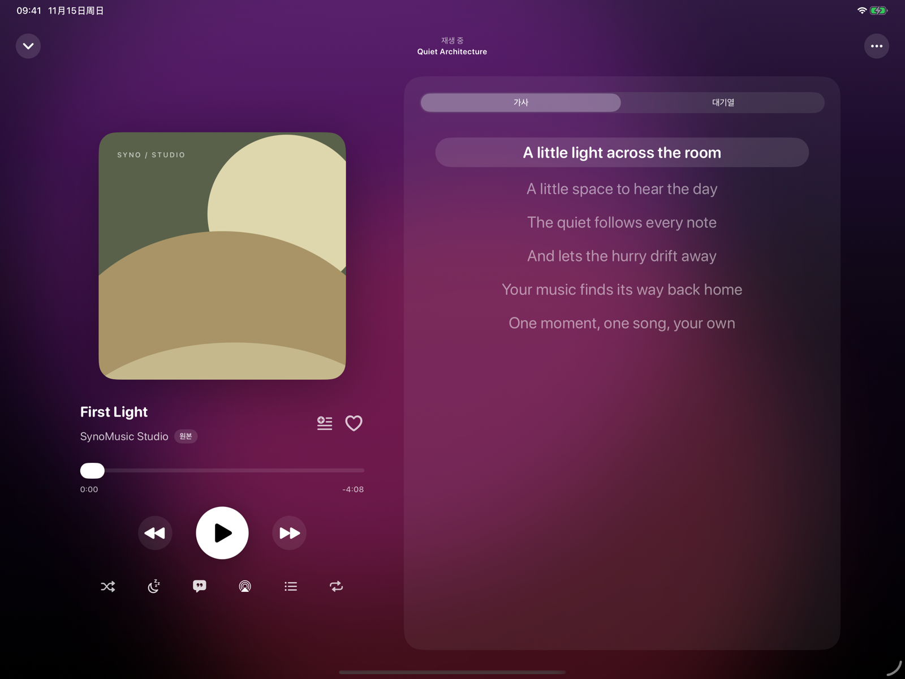
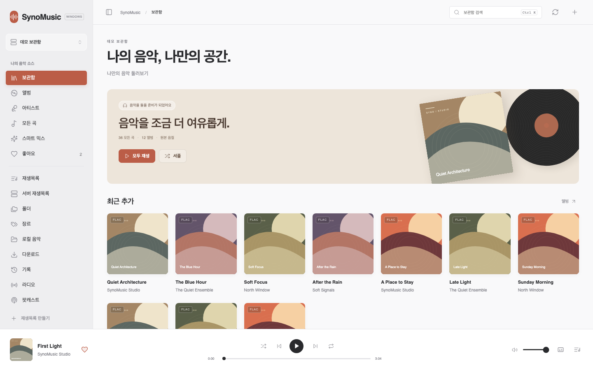
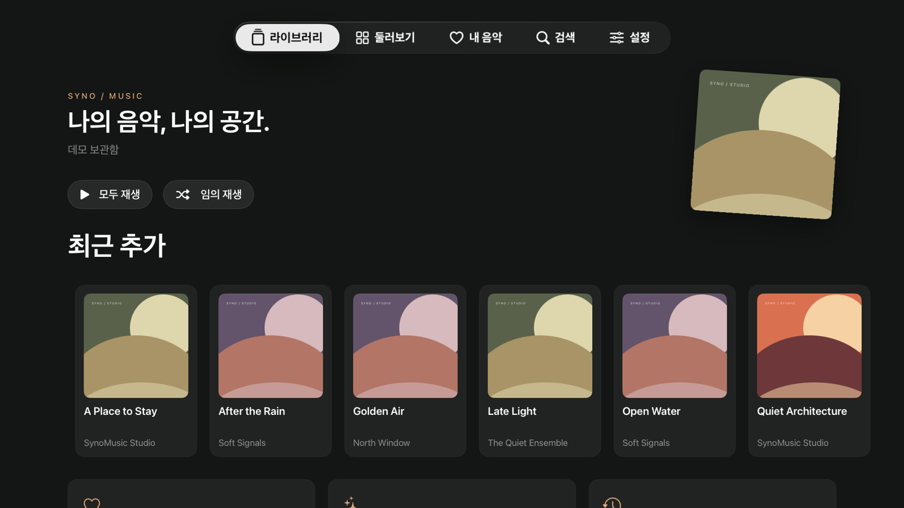

<p align="center">
  
</p>

# SynoMusic

내 음악을 위한 편안한 공간. **iPhone, iPad, Mac, Windows, Apple TV**에서 사용하는 무료 오픈 소스 음악 클라이언트입니다.

[English](README.md) · [简体中文](README.zh.md) · [日本語](README.ja.md) · [한국어](README.ko.md)

[공식 웹사이트](https://zanwingmak.github.io/SynoMusic/) · [App Store](https://apps.apple.com/app/id6784094020) · [데스크톱 다운로드](https://github.com/ZanwingMak/SynoMusic/releases/latest) · [문제 제보](https://github.com/ZanwingMak/SynoMusic/issues)

Synology Audio Station, Plex, Jellyfin, Emby, WebDAV, SMB 음악 라이브러리에 연결할 수 있습니다. 휴대전화, 태블릿, 데스크톱에서는 로컬 오디오 파일도 가져올 수 있습니다. 터치 화면, 데스크톱, Siri Remote에 맞춰 각 클라이언트의 화면을 설계했습니다.

**모든 기능이 무료입니다.** 선택적인 후원 구매는 개발자를 응원하기 위한 것으로, 기능을 잠금 해제하거나 자동 갱신되지 않습니다. SynoMusic 계정은 필요하지 않으며 상용 음악 카탈로그는 포함하지 않습니다.

## 다운로드

| 클라이언트 | 요구 사항 | 버전 | 다운로드 |
| --- | --- | --- | --- |
| iPhone | iOS 17 이상 | 1.7.0 | [App Store](https://apps.apple.com/app/id6784094020) |
| iPad | iPadOS 17 이상 | 1.7.0 | [App Store](https://apps.apple.com/app/id6784094020) |
| Mac | macOS 13 이상, Apple Silicon / Intel | 1.6.12 | [App Store](https://apps.apple.com/app/id6784094020) · [유니버설 DMG](https://github.com/ZanwingMak/SynoMusic/releases/download/v1.6.12/SynoMusic-1.6.12-mac-universal.dmg) |
| Windows | Windows 10/11, WebView2 Runtime | 1.6.12 | [x64 설치 파일](https://github.com/ZanwingMak/SynoMusic/releases/download/v1.6.12/SynoMusic-1.6.12-Windows-x64-setup.exe) · [ARM64 설치 파일](https://github.com/ZanwingMak/SynoMusic/releases/download/v1.6.12/SynoMusic-1.6.12-Windows-arm64-setup.exe) |
| Apple TV | tvOS 17 이상 | 1.7.0 | [App Store](https://apps.apple.com/app/id6784094020) — Apple TV에서 SynoMusic 검색 |

Mac DMG는 Developer ID 서명과 Apple 공증을 완료했습니다. 데스크톱 설치 파일과 SHA-256 체크섬은 [GitHub Releases](https://github.com/ZanwingMak/SynoMusic/releases/latest)에서 확인할 수 있습니다.

## 스크린샷

### Mac



| iPhone | iPad |
| :---: | :---: |
|  |  |

| Windows | Apple TV |
| :---: | :---: |
|  |  |

스크린샷은 직접 제작한 데모 라이브러리를 사용합니다. 표시된 음악이 앱에 포함된다는 뜻은 아닙니다.

## 음악 소스와 라이브러리

- **내 서버 연결**: Synology Audio Station, Plex, Jellyfin, Emby, WebDAV, SMB. 여러 서버 프로필과 Synology QuickConnect 지원.
- **컬렉션 탐색**: 앨범, 아티스트, 장르, 폴더, 모든 곡, 서버 플레이리스트 및 검색.
- **내 음악 정리**: 즐겨찾기, 로컬 플레이리스트, 스마트 믹스 및 재생 기록.
- **곡에 맞춰 듣기**: 동기화 가사, 재생 대기열, 셔플, 반복 및 수면 타이머.
- **오프라인 재생**: iPhone, iPad, Mac, Windows에서 다운로드 및 로컬 오디오 가져오기.
- **다양한 오디오**: 라디오와 팟캐스트 탐색, 검색 및 재생.
- **인터페이스 언어**: 중국어 간체·번체, 영어, 일본어, 한국어, 독일어, 프랑스어.

사용할 수 있는 서버 기능은 서비스 종류와 계정 권한에 따라 다릅니다. 소유하거나 접근 권한을 받은 음악만 연결해 주세요.

## 클라이언트별 특징

### iPhone과 iPad

- SwiftUI 네이티브 화면, 백그라운드 재생, AirPlay, 잠금 화면 제어 및 Dynamic Island.
- 위젯, Siri 단축어, 선택적 iCloud 설정 동기화, 테마 색상 및 대체 앱 아이콘.
- 동기화 가사 편집, 글자 크기 및 표시 시간 조정.
- iPad 라이브러리 사이드바, 반응형 앨범 그리드, 앨범 이미지·가사·대기열을 넓게 보여 주는 플레이어.
- iPhone Duo의 접힘, 부분 펼침, 완전 펼침 레이아웃 지원. 화면 공간이 바뀌어도 탐색과 검색 상태 유지.

### Mac과 Windows

- [MyGo](https://github.com/egoist/mygo), Go, TypeScript 및 시스템 WebView를 사용하는 데스크톱 화면.
- 메뉴 막대 / 시스템 트레이 재생 제어, 창을 닫은 후 재생 유지 설정, 미니 플레이어, 미디어 키 및 키보드 단축키.
- 즐겨찾기, 동기화 가사, 가사 가져오기·내보내기, 대기열 편집 및 대기열 기록.
- 10밴드 이퀄라이저, 크로스페이드, ReplayGain(지원 태그 필요), 좌우 밸런스 및 A–B 반복.
- 별점, 청취 통계, 조건 기반 스마트 플레이리스트. M3U/M3U8/JSON 가져오기와 M3U8/JSON 내보내기.
- **Studio, Graphite, Evergreen, Sea glass, Rosewood, Amber**의 6가지 스킨. 각 스킨에서 밝게, 어둡게, 시스템 설정 따르기 지원.

### Apple TV

- 리모컨 초점, 원거리 가독성, 큰 앨범 이미지에 맞춘 전용 SwiftUI 화면.
- 서버 음악 라이브러리, 앨범, 아티스트, 폴더, 장르, 검색 및 서버 플레이리스트.
- 즐겨찾기, 로컬 플레이리스트, 스마트 믹스, 기록, 동기화 가사, 대기열 및 수면 타이머.

## 개인정보와 선택적 후원

서버 자격 증명은 Apple 플랫폼에서 Keychain, Windows에서 자격 증명 관리자에 저장합니다. 앱은 직접 설정한 서버에 연결합니다. iCloud 동기화는 선택 사항이며, Mac에서는 App Store 버전에서 사용할 수 있습니다. 설정 동기화로 다운로드한 오디오나 로컬 파일을 업로드하지 않습니다.

iPhone과 iPad의 후원 구매는 미국 달러 기준 **$0.99, $1.99, $2.99, $5.99, $9.99**의 5가지입니다. 모두 반복 구매 가능한 일회성 소모품이며 실제 현지 가격은 App Store에 표시됩니다.

이전 구독은 별도로 관리해야 하며 앱 업데이트로 자동 취소되지 않습니다. 설정의 이전 구독 관리에서 확인하거나 취소할 수 있습니다.

[개인정보 처리방침](https://zanwingmak.github.io/SynoMusic/privacy.html) · [이용 약관](https://zanwingmak.github.io/SynoMusic/terms.html)

## 소스에서 빌드

```bash
git clone https://github.com/ZanwingMak/SynoMusic.git
cd SynoMusic
```

### iPhone, iPad, Apple TV

macOS, Xcode 27.2 이상, [XcodeGen](https://github.com/yonaskolb/XcodeGen)이 필요합니다.

```bash
brew install xcodegen
xcodegen generate
open SynoMusic.xcodeproj
```

iPhone / iPad는 **SynoMusic**, Apple TV는 **SynoMusicTV** 스킴을 선택합니다. 실제 기기 빌드에는 본인의 개발 팀과 서명 설정을 사용하세요. iCloud 기능에도 본인의 식별자와 권한 설정이 필요합니다.

### Mac과 Windows

데스크톱 빌드 설정에 맞춰 Node.js 24와 Go 1.27.3 이상을 사용합니다.

```bash
cd desktop
npm ci
```

Mac에서는 Xcode 명령줄 도구를 설치하고 개발 실행 전에 네이티브 브리지를 빌드합니다.

```bash
npm run build:native
npm run dev
```

Windows에서는 의존성 설치 후 `npm run dev`를 실행합니다. 배포 빌드는 macOS에서 `npm run build:mac`, Windows에서 `npm run build:windows`를 사용합니다. Windows 빌드는 x64와 ARM64 설치 파일을 생성합니다. 배포 서명과 공증에는 본인의 자격 증명이 필요합니다.

## 저장소 구조

- [`SynoMusic/`](SynoMusic/): iPhone / iPad 앱, 공통 제공자, 저장소, 위젯 및 Live Activities.
- [`SynoMusicTV/`](SynoMusicTV/): Apple TV 앱과 리모컨 화면.
- [`desktop/`](desktop/): Mac / Windows 앱, MyGo 서비스, 플레이어 및 스킨.
- [`docs/`](docs/): 공식 웹사이트, 다국어 스크린샷, 개인정보 처리방침 및 이용 약관.
- [`project.yml`](project.yml): XcodeGen 프로젝트와 Apple 플랫폼 스킴 설정.

현재 공개 개발 저장소는 [ZanwingMak/SynoMusic](https://github.com/ZanwingMak/SynoMusic)입니다. 문제 제보와 코드 기여는 이 저장소에서 진행합니다.

## 고지 및 라이선스

SynoMusic은 독립적인 비공식 클라이언트입니다. Synology, Plex, Jellyfin, Emby, Apple 등의 명칭은 각 소유자에게 있습니다. 해당 프로젝트나 회사와 제휴되어 있거나 보증받은 제품이 아닙니다.

**GNU General Public License v3.0**에 따라 배포됩니다. [LICENSE](LICENSE)를 참고하세요.
