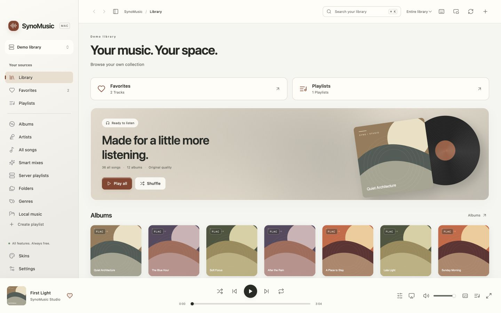
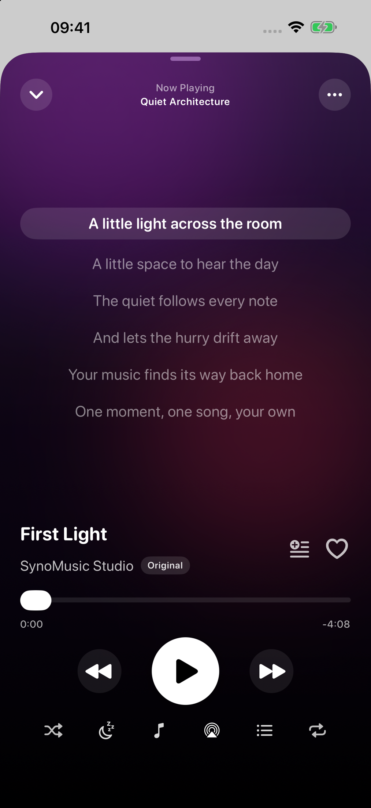
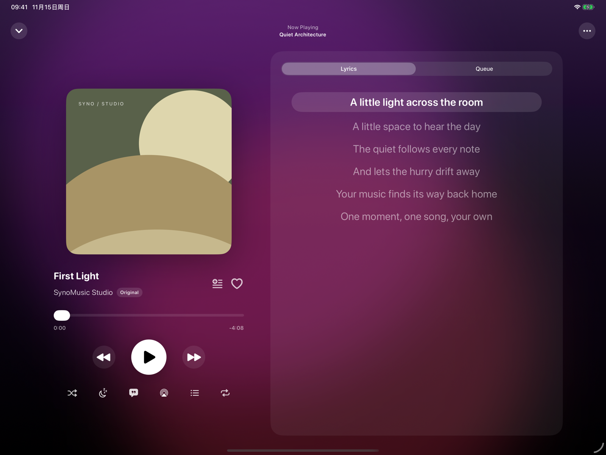
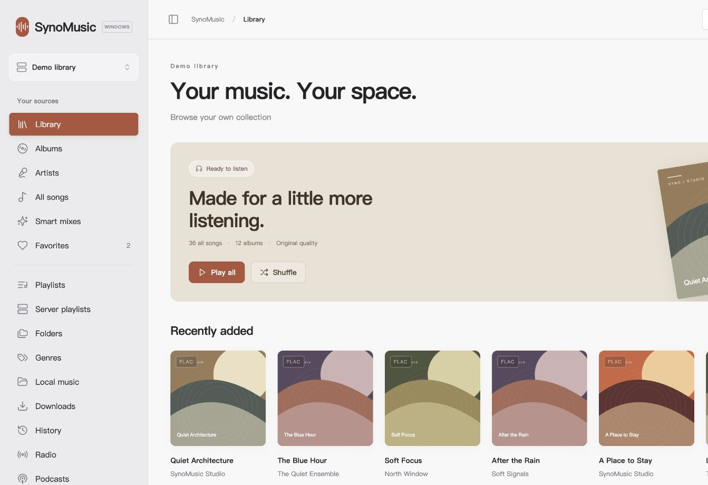
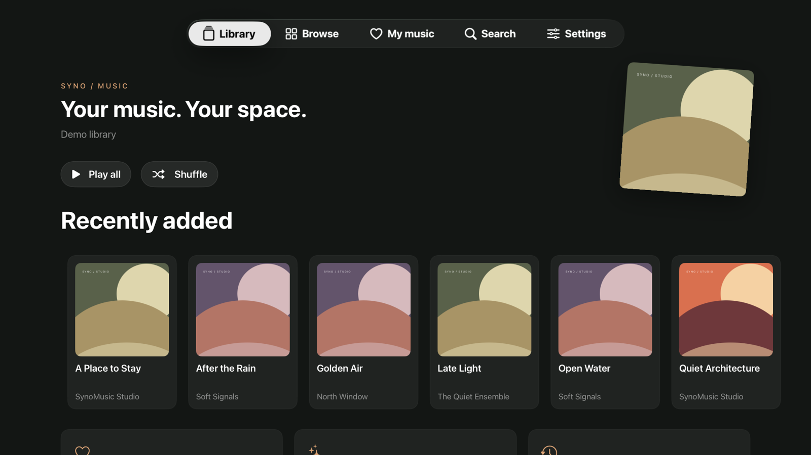

<p align="center">
  
</p>

# SynoMusic

Your music, at home. Free, open-source music clients for **iPhone, iPad, Mac, Windows and Apple TV**.

[English](README.md) · [简体中文](README.zh.md) · [日本語](README.ja.md) · [한국어](README.ko.md)

[Website](https://zanwingmak.github.io/SynoMusic/) · [App Store](https://apps.apple.com/app/id6784094020) · [Desktop downloads](https://github.com/ZanwingMak/SynoMusic/releases/latest) · [Report an issue](https://github.com/ZanwingMak/SynoMusic/issues)

Connect your Synology Audio Station, Plex, Jellyfin, Emby, WebDAV or SMB music library, or listen to local files on your phone, tablet or desktop. Each client has a layout designed for its screen, from a pocket player to a desktop workspace and a Siri Remote interface.

**All features are free.** Optional support purchases thank the developer; they do not unlock features or renew automatically. SynoMusic does not include a commercial music catalog or require a SynoMusic account.

## Get the app

| Client | Requirements | Version | Download |
| --- | --- | --- | --- |
| iPhone | iOS 17+ | 1.7.0 | [App Store](https://apps.apple.com/app/id6784094020) |
| iPad | iPadOS 17+ | 1.7.0 | [App Store](https://apps.apple.com/app/id6784094020) |
| Mac | macOS 13+, Apple Silicon or Intel | 1.6.12 | [App Store](https://apps.apple.com/app/id6784094020) · [Universal DMG](https://github.com/ZanwingMak/SynoMusic/releases/download/v1.6.12/SynoMusic-1.6.12-mac-universal.dmg) |
| Windows | Windows 10/11, WebView2 Runtime | 1.6.12 | [x64 installer](https://github.com/ZanwingMak/SynoMusic/releases/download/v1.6.12/SynoMusic-1.6.12-Windows-x64-setup.exe) · [ARM64 installer](https://github.com/ZanwingMak/SynoMusic/releases/download/v1.6.12/SynoMusic-1.6.12-Windows-arm64-setup.exe) |
| Apple TV | tvOS 17+ | 1.7.0 | [App Store](https://apps.apple.com/app/id6784094020) — search for SynoMusic on Apple TV |

The Mac DMG is Developer ID signed and notarized by Apple. Desktop release files and SHA-256 checksums are available in [GitHub Releases](https://github.com/ZanwingMak/SynoMusic/releases/latest).

## Screenshots

### Mac



| iPhone | iPad |
| :---: | :---: |
|  |  |

| Windows | Apple TV |
| :---: | :---: |
|  |  |

Screenshots use an original demo library. They do not represent a music catalog included with the app.

## Music sources and library

- **Connect your servers:** Synology Audio Station, Plex, Jellyfin, Emby, WebDAV and SMB, with multiple server profiles and QuickConnect support for Synology.
- **Browse your collection:** albums, artists, genres, folders, all songs, server playlists and search.
- **Keep your favorites close:** favorites, personal playlists, smart mixes and playback history.
- **Follow the song:** synced lyrics, a playback queue, shuffle, repeat and a sleep timer.
- **Listen offline:** downloads and local file imports on iPhone, iPad, Mac and Windows.
- **Explore audio:** radio stations and podcasts alongside your music library.
- **Choose your language:** Simplified Chinese, Traditional Chinese, English, Japanese, Korean, German and French.

Server features depend on the provider and your account permissions. Use your own music or content you are authorized to access.

## Designed for each screen

### iPhone and iPad

- Native SwiftUI interface, background playback, AirPlay, Lock Screen controls and Dynamic Island.
- Widgets, Siri shortcuts, optional iCloud configuration sync, theme colors and alternate app icons.
- Synced lyrics with editing, text size and timing adjustments.
- iPad sidebar, adaptive album grids, and a spacious player with artwork, lyrics and queue.
- iPhone Duo layouts for folded, partially open and fully open use, preserving navigation and search as the available space changes.

### Mac and Windows

- A desktop interface built with [MyGo](https://github.com/egoist/mygo), Go and TypeScript, using the system WebView.
- Menu bar / system tray playback controls, configurable close-to-tray behavior, a mini player, media keys and keyboard shortcuts.
- Favorites, synced lyrics, lyrics import/export, queue editing and queue history.
- A 10-band equalizer, crossfade, ReplayGain when tags are available, balance and A–B repeat.
- Ratings, listening statistics, rule-based smart playlists, and M3U/M3U8/JSON playlist import with M3U8/JSON export.
- Six skins: **Studio, Graphite, Evergreen, Sea glass, Rosewood and Amber**, each with light, dark and system appearance modes.

### Apple TV

- A dedicated SwiftUI interface with visible focus states, large artwork and Siri Remote navigation.
- Server music libraries, albums, artists, folders, genres, search and server playlists.
- Favorites, personal playlists, smart mixes, history, synced lyrics, queue and sleep timer.

## Privacy and optional support

Server credentials are stored in Apple Keychain on Apple platforms and Windows Credential Manager on Windows. Connections use the servers you configure. iCloud sync is optional; on Mac, it is available in the App Store build. Downloaded audio and local files are not uploaded through configuration sync.

Support purchases are available in the iPhone and iPad app at USD reference prices of **$0.99, $1.99, $2.99, $5.99 and $9.99**. Each is a repeatable, one-time consumable purchase. The App Store displays your local price.

Earlier subscriptions are managed separately and are not automatically cancelled by an app update. Use **Manage previous subscriptions** in Settings to review or cancel them.

[Privacy Policy](https://zanwingmak.github.io/SynoMusic/privacy.html) · [Terms of Use](https://zanwingmak.github.io/SynoMusic/terms.html)

## Build from source

```bash
git clone https://github.com/ZanwingMak/SynoMusic.git
cd SynoMusic
```

### iPhone, iPad and Apple TV

Use macOS, Xcode 27.2 or later, and [XcodeGen](https://github.com/yonaskolb/XcodeGen).

```bash
brew install xcodegen
xcodegen generate
open SynoMusic.xcodeproj
```

Choose the **SynoMusic** scheme for iPhone/iPad or **SynoMusicTV** for Apple TV. Use your own development team and signing configuration for device builds; iCloud capabilities also require your own identifiers and entitlements.

### Mac and Windows

Use Node.js 24 and Go 1.27.3 or later, matching the desktop build configuration.

```bash
cd desktop
npm ci
```

On Mac, install Xcode command-line tools, then build the native bridge before starting development:

```bash
npm run build:native
npm run dev
```

On Windows, run `npm run dev` after installing dependencies. For packaged builds, use `npm run build:mac` on macOS or `npm run build:windows` on Windows. The Windows build produces x64 and ARM64 installers. Distribution signing and notarization require your own credentials.

## Repository

- [`SynoMusic/`](SynoMusic/): iPhone/iPad app, shared providers, storage, widgets and Live Activities.
- [`SynoMusicTV/`](SynoMusicTV/): Apple TV app and remote-focused interface.
- [`desktop/`](desktop/): Mac/Windows app, MyGo services, player and skins.
- [`docs/`](docs/): official website, localized screenshots, privacy policy and terms.
- [`project.yml`](project.yml): XcodeGen project and Apple platform schemes.

This is the actively maintained public repository. Issues and contributions belong in [ZanwingMak/SynoMusic](https://github.com/ZanwingMak/SynoMusic).

## Disclaimer and license

SynoMusic is an independent, unofficial client. Synology, Plex, Jellyfin, Emby, Apple and other product names belong to their respective owners. SynoMusic is not affiliated with or endorsed by those projects or companies.

Licensed under the **GNU General Public License v3.0**. See [LICENSE](LICENSE).
