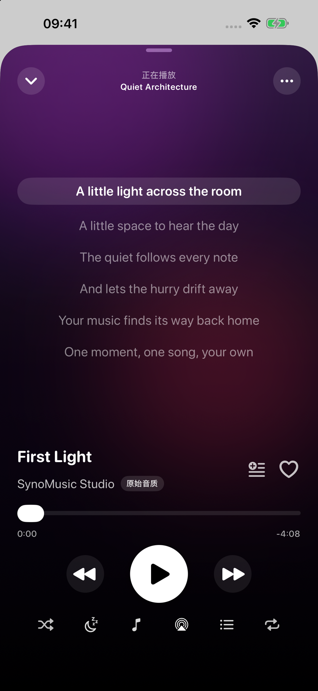
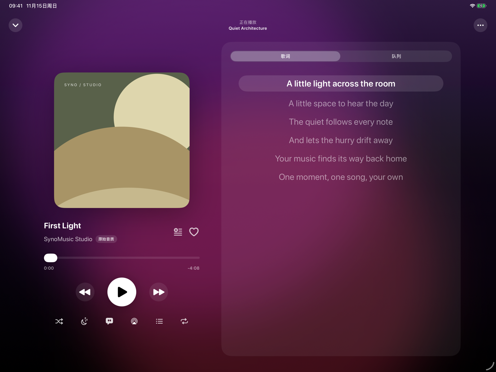
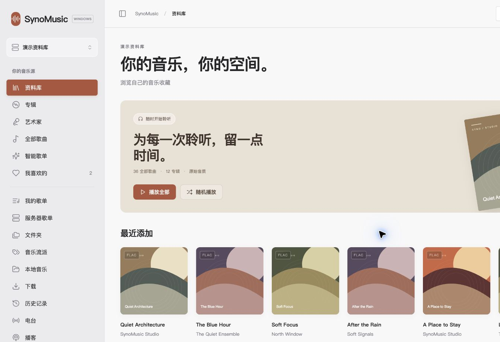
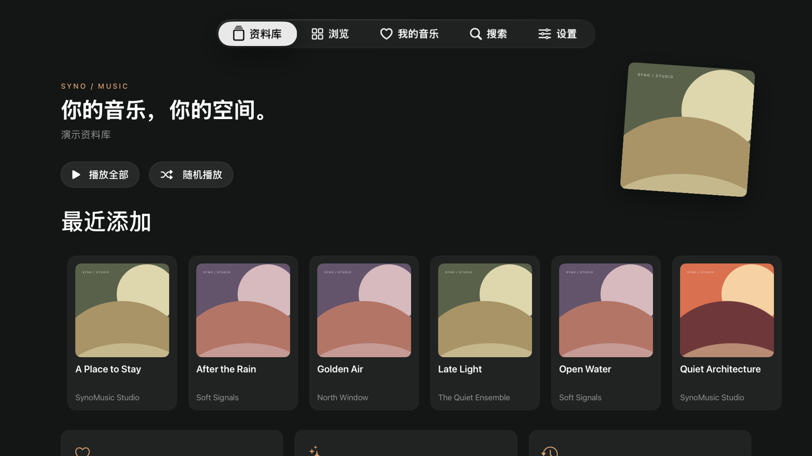

<p align="center">
  
</p>

# SynoMusic

给自己的音乐一个家。免费、开源的私人音乐库客户端，支持 **iPhone、iPad、Mac、Windows 和 Apple TV**。

[English](README.md) · [简体中文](README.zh.md) · [日本語](README.ja.md) · [한국어](README.ko.md)

[官网](https://zanwingmak.github.io/SynoMusic/) · [App Store](https://apps.apple.com/app/id6784094020) · [桌面版下载](https://github.com/ZanwingMak/SynoMusic/releases/latest) · [反馈问题](https://github.com/ZanwingMak/SynoMusic/issues)

连接自己的群晖 Audio Station、Plex、Jellyfin、Emby、WebDAV 或 SMB 音乐库，也可以在手机、平板和电脑上导入本地音频。各客户端分别针对触屏、桌面和 Siri Remote 遥控器设计布局。

**全部功能免费开放。** 内购仅用于自愿赞助开发，不解锁功能、不自动续费。无需注册 SynoMusic 账号，App 不附带商业曲库。

## 下载

| 客户端 | 系统要求 | 版本 | 下载入口 |
| --- | --- | --- | --- |
| iPhone | iOS 17+ | 1.7.0 | [App Store](https://apps.apple.com/app/id6784094020) |
| iPad | iPadOS 17+ | 1.7.0 | [App Store](https://apps.apple.com/app/id6784094020) |
| Mac | macOS 13+，Apple Silicon / Intel | 1.6.12 | [App Store](https://apps.apple.com/app/id6784094020) · [通用版 DMG](https://github.com/ZanwingMak/SynoMusic/releases/download/v1.6.12/SynoMusic-1.6.12-mac-universal.dmg) |
| Windows | Windows 10/11，WebView2 Runtime | 1.6.12 | [x64 安装包](https://github.com/ZanwingMak/SynoMusic/releases/download/v1.6.12/SynoMusic-1.6.12-Windows-x64-setup.exe) · [ARM64 安装包](https://github.com/ZanwingMak/SynoMusic/releases/download/v1.6.12/SynoMusic-1.6.12-Windows-arm64-setup.exe) |
| Apple TV | tvOS 17+ | 1.7.0 | [App Store](https://apps.apple.com/app/id6784094020)，在 Apple TV 商店搜索 SynoMusic |

Mac DMG 已完成 Developer ID 签名和苹果公证。桌面版安装包及 SHA-256 校验文件见 [GitHub Releases](https://github.com/ZanwingMak/SynoMusic/releases/latest)。

## 界面预览

### Mac


| iPhone | iPad |
| :---: | :---: |
|  |  |

| Windows | Apple TV |
| :---: | :---: |
|  |  |

截图使用原创演示资料库，不代表 App 提供这些音乐内容。

## 音乐源与资料库

- **连接自己的服务器**：群晖 Audio Station、Plex、Jellyfin、Emby、WebDAV、SMB；支持多服务器配置及群晖 QuickConnect。
- **浏览与搜索**：专辑、艺术家、流派、文件夹、所有歌曲和服务器歌单。
- **整理自己的音乐**：我的喜欢、本地歌单、智能歌单和播放历史。
- **跟随歌曲播放**：动态歌词、播放队列、随机播放、循环播放和睡眠定时。
- **离线收听**：iPhone、iPad、Mac、Windows 支持下载及本地音频导入。
- **更多音频内容**：电台与播客浏览、搜索和播放。
- **多语言界面**：简体中文、繁体中文、英语、日语、韩语、德语和法语。

服务器功能取决于音乐源类型及账号权限。请仅连接自己拥有或获准访问的音乐内容。

## 各客户端特色

### iPhone 与 iPad

- 原生 SwiftUI 界面，支持后台播放、AirPlay、锁屏控制和灵动岛。
- 小组件、Siri 捷径、可选的 iCloud 配置同步、主题色与备用 App 图标。
- 同步歌词、歌词编辑、字号及时间偏移调整。
- iPad 资料库侧栏、自适应专辑网格，封面、歌词和队列拥有更充裕的展示空间。
- iPhone Duo 支持折叠、半展开和完全展开布局，空间变化时保留导航和搜索状态。

### Mac 与 Windows

- 使用 [MyGo](https://github.com/egoist/mygo)、Go 和 TypeScript 构建，通过系统 WebView 呈现桌面界面。
- 菜单栏 / 系统托盘播放控制、可设置关闭窗口后继续播放、迷你播放器、系统媒体键及键盘快捷键。
- 我的喜欢、动态歌词、歌词导入导出、队列编辑及队列历史。
- 十段均衡器、淡入淡出、ReplayGain（需音频标签支持）、声道平衡和 A–B 循环。
- 歌曲评分、聆听统计、规则智能歌单；支持导入 M3U/M3U8/JSON 歌单，导出 M3U8/JSON。
- 六套皮肤：**Studio、Graphite、Evergreen、Sea glass、Rosewood、Amber**，均支持浅色、深色和跟随系统。

### Apple TV

- 独立 SwiftUI 界面，针对遥控器焦点、远距离阅读和大屏封面设计。
- 服务器音乐库、专辑、艺术家、文件夹、流派、搜索及服务器歌单。
- 我的喜欢、本地歌单、智能歌单、历史记录、动态歌词、播放队列和睡眠定时。

## 隐私与自愿赞助

Apple 平台的服务器凭证保存在系统钥匙串，Windows 使用凭据管理器。App 连接你配置的服务器。iCloud 同步可以自行开启；Mac 的 iCloud 功能在 App Store 版本中提供。配置同步不会上传下载的音频或本地文件。

iPhone 和 iPad 内提供五档自愿赞助，美元基准价为 **$0.99、$1.99、$2.99、$5.99、$9.99**。均为可重复购买的单次消耗型内购，实际价格以 App Store 显示的当地价格为准。

历史订阅需要单独管理，更新 App 不会自动取消。可在设置中的**管理历史订阅**查看或取消。

[隐私政策](https://zanwingmak.github.io/SynoMusic/privacy.html) · [服务条款](https://zanwingmak.github.io/SynoMusic/terms.html)

## 从源码构建

```bash
git clone https://github.com/ZanwingMak/SynoMusic.git
cd SynoMusic
```

### iPhone、iPad 与 Apple TV

需要 macOS、Xcode 27.2 或更新版本，以及 [XcodeGen](https://github.com/yonaskolb/XcodeGen)。

```bash
brew install xcodegen
xcodegen generate
open SynoMusic.xcodeproj
```

iPhone / iPad 选择 **SynoMusic** Scheme，Apple TV 选择 **SynoMusicTV**。真机运行需使用自己的开发者团队和签名配置；iCloud 功能也需配置自己的标识与权限。

### Mac 与 Windows

使用 Node.js 24、Go 1.27.3 或更新版本，与桌面端构建配置保持一致。

```bash
cd desktop
npm ci
```

Mac 需安装 Xcode 命令行工具，并在开发运行前构建原生桥接库：

```bash
npm run build:native
npm run dev
```

Windows 安装依赖后运行 `npm run dev`。打包时，在 macOS 上执行 `npm run build:mac`，在 Windows 上执行 `npm run build:windows`；后者会生成 x64 和 ARM64 安装包。分发签名及公证需要使用自己的凭证。

## 仓库结构

- [`SynoMusic/`](SynoMusic/)：iPhone / iPad App、共享音乐源、存储、小组件和实时活动。
- [`SynoMusicTV/`](SynoMusicTV/)：Apple TV App 与遥控器界面。
- [`desktop/`](desktop/)：Mac / Windows 客户端、MyGo 服务、播放器和皮肤。
- [`docs/`](docs/)：官网、多语言截图、隐私政策及服务条款。
- [`project.yml`](project.yml)：XcodeGen 工程与 Apple 平台 Scheme 配置。

当前维护的公开仓库为 [ZanwingMak/SynoMusic](https://github.com/ZanwingMak/SynoMusic)，问题反馈和代码贡献统一在此进行。

## 免责声明与许可证

SynoMusic 是独立开发的非官方客户端。Synology、Plex、Jellyfin、Emby、Apple 等名称归各自所有者所有，SynoMusic 与这些项目或公司没有从属或背书关系。

本项目使用 **GNU General Public License v3.0**。详见 [LICENSE](LICENSE)。
